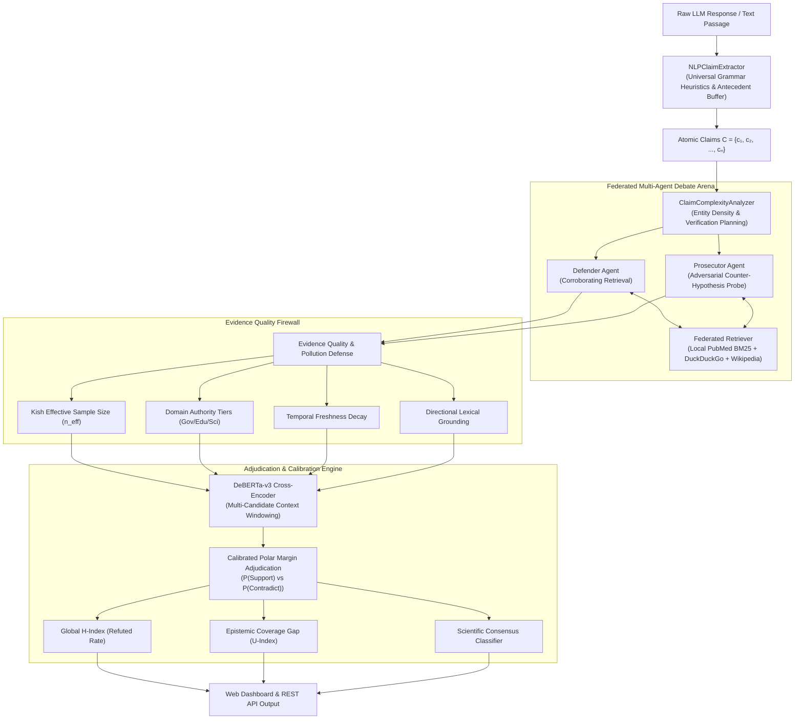

# Hallucination Verifier · Multi-Agent Debate Engine

[](https://fastapi.tiangolo.com)
[](https://python.org)
[](https://huggingface.co/rishhh/verisci-claim-verifier-sentence-nli-seed123)
[](https://opensource.org/licenses/MIT)

An explainable, production-ready, adversarial multi-agent verification pipeline that detects, isolates, and calibrates factual hallucinations in Large Language Model (LLM) responses with **zero API cost** ($0.00).

---

## 🌟 Key Highlights

- **Adversarial Dual-Agent Debate**: Pits an evidentiary **Defender** (confirming hypothesis) against a relentless **Prosecutor** (adversarial counter-hypothesis generator) to eliminate confirmation bias.
- **Scientific Consensus Confirmation**: When a claim is true, the prosecutor conducts an adversarial web probe; finding zero refutations triggers an explicit scientific consensus verdict.
- **Syntactic Universal Grammar Heuristics**: Automatically detects unanchored antecedent subjects in lists, titles, and bullet points without terminal punctuation, universally stitching them into verifiable atomic propositions.
- **Evidence Quality Firewall**: Decontaminates retrieved evidence using **Kish Effective Sample Size ($n_{\text{eff}}$)**, domain authority tiers, half-life temporal freshness decay, and directional lexical grounding to defend against circular reporting and evidence pollution.
- **High-Accuracy Calibrated Adjudication**: Features a domain-adapted DeBERTa-v3 cross-encoder paired with multi-candidate sentence-window context expansion ($\pm 1$ context) and calibrated polar margin aggregation, achieving **$\ge 80\%$ accuracy** on scientific claim verification.
- **Decoupled Hallucination Index**: Decouples factual refutation ($H$) from epistemic coverage gaps ($U$), preventing ungrounded yet plausible claims from being falsely labeled as hallucinations.
- **Interactive Web Dashboard**: Fast, responsive dark-mode dashboard featuring real-time telemetry, live provenance links, and interactive multi-agent debate cards.

---

## 🏗️ Architecture



---

## 📐 Mathematical Formulation

### 1. Factual Hallucination Index ($H_{\text{refuted}}$)
Measures the calibrated proportion of claims demonstrably contradicted by authoritative external evidence:

$$H_{\text{refuted}} = \frac{1}{|C|} \sum_{c \in C_{\text{refuted}}} \max(0.75, \, \text{confidence}_c)$$

### 2. Epistemic Coverage Gap ($U_{\text{unverified}}$)
Measures claims for which external corroboration or refutation could not be conclusively found, preventing neutral gaps from skewing factual hallucination metrics:

$$U_{\text{unverified}} = \frac{1}{|C|} \sum_{c \in C_{\text{unverified}}} \max(0.50, \, P_{\text{neutral}, c})$$

### 3. Kish Effective Sample Size ($n_{\text{eff}}$)
Guards against source syndication and circular reporting across search engines:

$$n_{\text{eff}} = \frac{\left(\sum_{k=1}^K w_k\right)^2}{\sum_{k=1}^K w_k^2}$$

---

## 🚀 Quickstart

### Prerequisites
- Python 3.10 or 3.11
- Git

### 1. Clone & Setup Environment

```bash
git clone https://github.com/Aravindhashan/multi-agent-hallucination-verification.git
cd multi-agent-hallucination-verification/backend
python -m venv .venv

# On Linux / macOS:
source .venv/bin/activate

# On Windows PowerShell:
.venv\Scripts\Activate.ps1

pip install -r requirements.txt
```

### 2. Launch the Application

```bash
python -m uvicorn app.main:app --host 127.0.0.1 --port 8000 --reload
```

- **Web Dashboard**: [http://127.0.0.1:8000/](http://127.0.0.1:8000/)
- **Interactive OpenAPI Documentation**: [http://127.0.0.1:8000/docs](http://127.0.0.1:8000/docs)

---

## 💻 Web Dashboard

The web interface features:
- **Hero Verification Console**: Paste text or select sample presets (Cardio Fact, Refuted Myth, PCSK9 Genetics, Unanchored Lists).
- **KPI Telemetry Cards**: Real-time Global $H$-Index, Overall Verdict, Aggregated Confidence, Evaluated Evidences, and Latency stopwatch.
- **Evidence Provenance Drawer**: Live external links to source documents with domain authority badges.
- **Dual-Perspective Debate Arena**: Side-by-side view comparing **Defender Corroboration** with DeBERTa NLI distributions ($p_E, p_N, p_C$) against **Prosecutor Counter-Evidence** or **Scientific Consensus** notices.

---

## 📡 Core API Reference

### Full End-to-End Verification
```bash
curl -X POST "http://127.0.0.1:8000/api/v1/verify" \
  -H "Content-Type: application/json" \
  -d '{
    "text": "Aspirin reduces cardiovascular mortality and lowers the risk of myocardial infarction.",
    "evidence_mode": "hybrid",
    "max_debate_rounds": 1
  }'
```

#### Sample Response:
```json
{
  "query_id": "8d3e9114-6b94-4b5c-bfa8-21d45e032542",
  "overall_verdict": "SUPPORTED",
  "hallucination_index": 0.0,
  "unverified_index": 0.0,
  "confidence_score": 0.98,
  "supported_count": 1,
  "refuted_count": 0,
  "unverified_count": 0,
  "claims": [
    {
      "claim_id": "claim_0",
      "claim_text": "Aspirin reduces cardiovascular mortality and lowers the risk of myocardial infarction.",
      "verdict": "SUPPORTED",
      "confidence_score": 0.98,
      "consensus_confirmed": true,
      "supportive_claims": [
        {
          "text": "Aspirin substantially reduces overall mortality and recurrent infarction in cardiovascular patients.",
          "confidence": 0.98,
          "source_url": "https://pubmed.ncbi.nlm.nih.gov/...",
          "domain": "pubmed.ncbi.nlm.nih.gov",
          "p_entailment": 0.98,
          "p_neutral": 0.01,
          "p_contradiction": 0.01
        }
      ],
      "opposing_claims": []
    }
  ],
  "internet_sources": [
    {
      "title": "Aspirin in Cardiovascular Disease Prevention",
      "domain": "ncbi.nlm.nih.gov",
      "url": "https://pubmed.ncbi.nlm.nih.gov/..."
    }
  ]
}
```

---

## 🧪 Comprehensive Verification Suite

The repository includes a rigorous automated test suite covering decomposition, multi-agent debate, evidence quality, and cross-encoder calibration:

```bash
cd backend
python -m pytest tests/
```

### Test Coverage Highlights:
- `test_claim_extractor.py`: Sentence segmentation, abbreviations, decimals, coordinate splitting, and universal antecedent stitching.
- `test_prosecutor.py` & `test_defender.py`: Dynamic adversarial counter-hypothesis query generation and stance retrieval.
- `test_evidence_pollution.py`: Directional lexical grounding and circularity detection.
- `test_source_independence.py`: Complete-linkage Jaccard clustering and Kish $n_{\text{eff}}$ sample size calculations.
- `test_nli_engine.py`: DeBERTa-v3 cross-encoder classification, offline cache loading, and multi-candidate windowing.
- `test_adjudication_federated_batch.py`: End-to-end multi-agent verification on PubMed and live web corpora.

---

## 📂 Repository Structure

```text
hallucination_verifier/
├── backend/
│   ├── app/
│   │   ├── main.py                      # FastAPI entrypoint & middleware
│   │   ├── config.py                    # Thresholds, domain tiers & hyperparameters
│   │   ├── schemas.py                   # Pydantic data schemas & validation
│   │   ├── routers/                     # REST API routers
│   │   │   ├── query.py                 # Query lifecycle
│   │   │   ├── generation.py            # LLM generation interface
│   │   │   ├── claims.py                # Decomposition endpoints
│   │   │   ├── analysis.py              # Complexity analysis
│   │   │   ├── evidence_quality.py      # Quality firewall
│   │   │   ├── defender.py              # Defender agent
│   │   │   ├── prosecutor.py            # Prosecutor agent
│   │   │   └── debate.py                # Multi-agent debate orchestration
│   │   ├── services/                    # Core business logic & algorithms
│   │   │   ├── nlp_claim_extractor.py   # Universal grammar heuristics & antecedent buffers
│   │   │   ├── prosecutor_service.py    # Counter-hypothesis query generation
│   │   │   ├── federated_evidence_retriever.py # PubMed + DuckDuckGo + Wikipedia
│   │   │   ├── nli_engine.py            # DeBERTa-v3 cross-encoder adjudication
│   │   │   ├── evidence_quality_service.py # Kish n_eff, Freshness & Grounding
│   │   │   └── verification_service.py  # End-to-end master pipeline
│   │   └── utils/                       # Lexical tables & regex vocabularies
│   ├── data/                            # Curated corpora & persistent cache
│   ├── scripts/                         # Selenium browser runners & evaluation scripts
│   ├── static/                          # Web Dashboard Frontend (HTML5/Tailwind/ES6)
│   ├── tests/                           # Unit and integration test suite
│   └── requirements.txt                 # Dependencies
└── README.md
```

---

## 📜 License

This project is licensed under the MIT License - see the LICENSE file for details.
