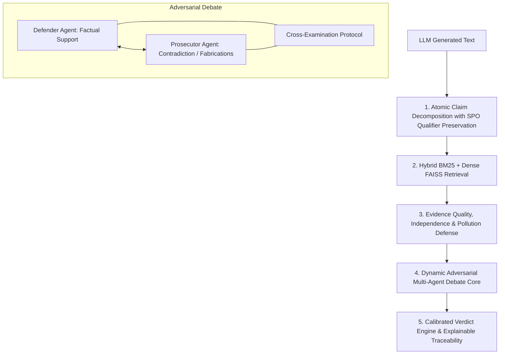
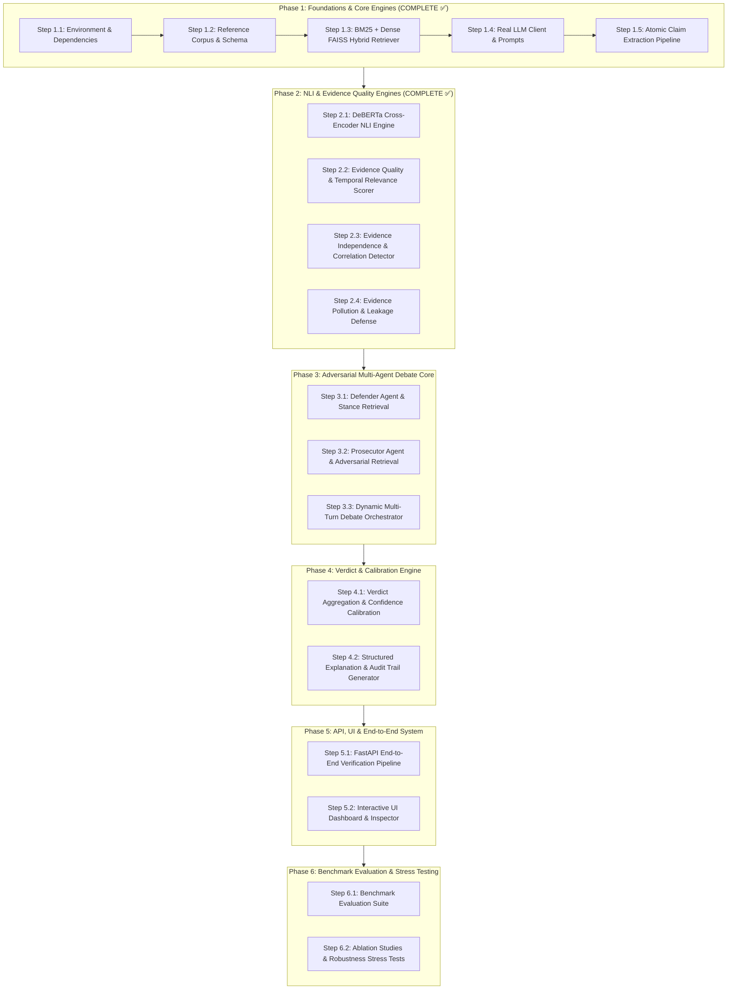

# Project Knowledge Graph: Dynamic Adversarial Multi-Agent Hallucination Verification

## 1. Project Overview & Research Objective
**Title**: *Dynamic Adversarial Multi-Agent Framework for Explainable Hallucination Verification in Large Language Models*

The objective of this framework is to provide rigorous, explainable, and calibrated factual verification of LLM-generated responses against a reference knowledge corpus. Unlike monolithic evaluators or simple cosine-similarity verification, this system decomposes responses into verifiable atomic claims, collects evidence using a hybrid retrieval engine (BM25 + Dense FAISS), and subjects each claim to an adversarial debate between a **Defender Agent** and a **Prosecutor Agent**, concluding in a calibrated, structured verdict.

---

## 2. Locked Research Novelty

### Core Novelty Pillars
1. **Atomic Claim Decomposition with Qualifier Preservation (Deterministic NLP Pipeline)**:
   - Deconstructs responses into fine-grained atomic claims using a **purely deterministic, rule-based NLP pipeline** (`NLPClaimExtractor`).
   - Replaces heavy dependency parsers (e.g. spaCy) with fast, transparent linguistic heuristics: coordinate conjunction splitting, participial phrase and recursive multi-fact appositive decomposition, and salient pronoun resolution.
   - Precision spatial anchor detection with negative lookaheads filtering out non-spatial entities (organizations, temporal quarters/days, documents, and historical events).
   - Bidirectional anchor invariant synchronization (`scalar == plural[0]`) preserving temporal, numerical, and spatial constraints.
2. **Hybrid Retrieval with High-Recall Indexing & Stance Adaptation**:
   - Combines deterministic lexical matching (BM25Okapi) and dense semantic vector search (`all-MiniLM-L6-v2` + FAISS L2-normalized Inner Product) with memory-safe lazy loading.
   - Stance differentiation: `supporting` stance for Defender factual retrieval; `contradicting` stance with controversy/refutation keyword augmentation for Prosecutor challenge.
3. **Evidence Quality, Source Independence & Pollution Detection**:
   - Assesses source credibility across 5 domain authority tiers (Gov/Edu, Academic, News, General Web, Low Credibility).
   - Evaluates temporal freshness via exponential half-life decay modeling.
   - Complete-linkage Jaccard clustering for source independence and syndication detection.
   - Directional lexical grounding defense to neutralize self-referential or polluted evidence and computes Kish Effective Sample Size ($n_{\text{eff}}$).
4. **Dynamic Adversarial Multi-Agent Debate**:
   - Structured multi-turn cross-examination between Defender (advocating factual adherence) and Prosecutor (probing discrepancies, exaggerations, or omissions).
5. **Calibrated Verdict & Natural Language Explanation Generation**:
   - Multi-class classification: `SUPPORTED`, `CONTRADICTED`, `UNVERIFIABLE`, `PARTIALLY_SUPPORTED`.
   - Cross-encoder NLI engine (DeBERTa-v3) with confidence calibration and granular claim-level provenance.

---

## 3. Architecture & Module Roadmap

---

## 4. Implementation Status Matrix

| Phase | Step | Description | Status | Verification Baseline |
|---|---|---|---|---|
| **Phase 1** | **1.1** | Environment & Dependencies Setup | **COMPLETE** | Dependencies locked & memory-safe lazy loading |
| **Phase 1** | **1.2** | Reference Corpus & Indexing Pipeline | **COMPLETE** | 21/21 Unit Tests Passed |
| **Phase 1** | **1.3** | BM25 + Dense FAISS Hybrid Retriever | **COMPLETE** | 23/23 Unit Tests Passed |
| **Phase 1** | **1.4** | Real LLM Client & Prompt Templates | **COMPLETE** | 18/18 Unit Tests Passed |
| **Phase 1** | **1.5** | Atomic Claim Extraction Pipeline (Deterministic Rule-Based) | **COMPLETE** | 41/41 Unit Tests Passed (Multi-fact appositive splitting, precision spatial anchors, anchor invariants) |
| **Phase 2** | **2.1** | DeBERTa Cross-Encoder NLI Engine | **COMPLETE** | 23/23 Unit Tests Passed |
| **Phase 2** | **2.2** | Source Credibility & Domain Authority Scorer | **COMPLETE** | 78/78 Unit Tests Passed |
| **Phase 2** | **2.3** | Temporal Freshness & Decay Scorer | **COMPLETE** | 40/40 Unit Tests Passed |
| **Phase 2** | **2.4** | Source Independence & Redundancy Detector | **COMPLETE** | 40/40 Unit Tests Passed |
| **Phase 2** | **2.5** | Evidence Pollution & Circularity Defense | **COMPLETE** | 27/27 Unit Tests Passed |
| **Integration**| **Wiring** | HybridRetriever Wiring into Defender & Prosecutor via `Depends()` | **COMPLETE** | Stance differentiation & router injection verified |
| **Integration**| **Session** | In-Memory Thread-Safe Session Store | **COMPLETE** | 8/8 Unit Tests Passed |
| **Benchmark**  | **Stress** | Domain-Diverse Decomposition Stress Benchmark (60 sentences) | **COMPLETE** | 100% High-Quality Claims (Atomicity: 1.0, Entailment: 0.998) |
| **Phase 3** | **3.1 - 3.3** | Multi-Turn Adversarial Debate Orchestrator | *READY* | Modules 5 & 6 standalone ready; multi-turn debate next |
| **Phase 4** | **4.1 - 4.2** | Calibrated Verdict & Aggregation Engine | *PENDING* | Blocked by Phase 3 |
| **Phase 5** | **5.1 - 5.2** | FastAPI End-to-End Verification Pipeline & UI | *PENDING* | Blocked by Phase 4 |
| **Phase 6** | **6.1 - 6.2** | Benchmark Evaluation & Ablation Suite | *PENDING* | Blocked by Phase 5 |
