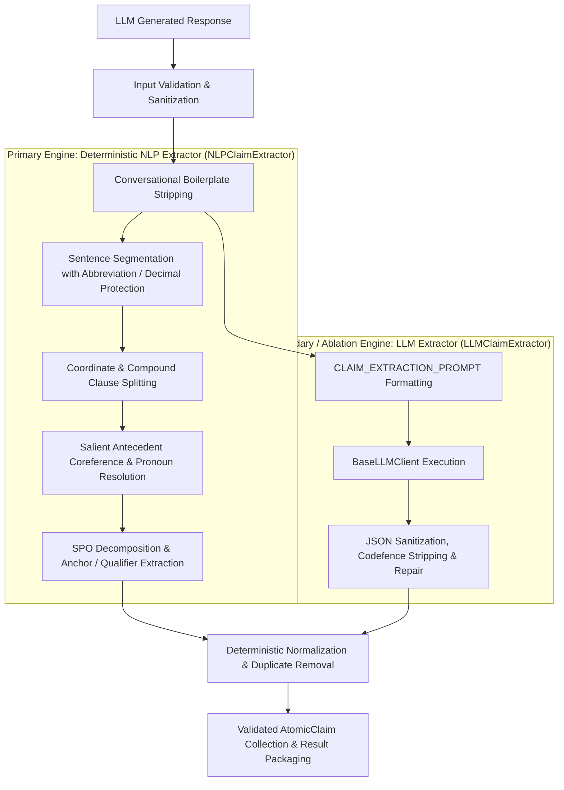

# Step 1.5 Status: Atomic Claim Extraction Pipeline

## Metadata
- **Phase**: Phase 1 — Foundations & Core Engines
- **Step**: Step 1.5
- **Title**: Atomic Claim Extraction Pipeline
- **Date**: 2026-09-16
- **Status**: COMPLETE

---

## 1. Objective
Transform unstructured, complex LLM-generated responses into fine-grained, structured, and independently verifiable `AtomicClaim` records. Each claim preserves vital factual qualifiers, numbers, measurements, dates, spatial entities, and subject-predicate-object (SPO) relationships to serve as the fundamental unit of investigation for the downstream verification and adversarial debate engines.

---

## 2. Architecture Decision & Justification

### Selected Architecture: Hybrid Dual-Engine Strategy (Deterministic NLP Primary + LLM Optional / Refinement / Ablation)

### Justification:
1. **Interpretability & Reproducibility**: The primary `NLPClaimExtractor` is 100% deterministic, transparent, and operates in <2ms with zero external API dependencies or token costs.
2. **Qualifier & Anchor Preservation**: Rule-based regexes and linguistic pattern matchers explicitly detect and preserve numbers (`299,792,458`), units (`meters per second`), temporal constraints (`1969`, `1991`), spatial anchors (`on the Moon`, `in France`), and restrictive qualifiers (`in vacuum`, `approximately`, `first person to walk on the Moon`).
3. **Compound Splitting & Coreference Resolution**: Decomposes compound coordinate sentences (`Apollo 11 landed on the Moon in 1969 and Neil Armstrong became...`) into single-fact claims and resolves ambiguous anaphora (`He first released it...` -> `Guido van Rossum first released Python...`).
4. **Research Ablation & Comparison**: Retaining `LLMClaimExtractor` powered by `CLAIM_EXTRACTION_PROMPT` enables direct experimental comparison between rule-based extraction vs. LLM-based extraction during Phase 6 benchmarks.

---

## 3. NLP Components Used

| Component | Status | Description & Purpose |
|---|---|---|
| **Sentence Segmentation** | **PASS** | Splits paragraphs into sentences while protecting decimals (`3.14`, `299,792,458.0`) and abbreviations (`Dr.`, `U.S.`, `Jan.`, `Prof.`, `etc.`). |
| **Tokenization & Delimiters** | **PASS** | Identifies word boundaries, punctuation, and clause conjunction delimiters. |
| **POS / Verb Phrase Parsing** | **PASS** | Detects active/passive verb patterns (`was created by`, `landed on`, `became`, `is the capital of`, `discovered`, `first released in`). |
| **SPO Decomposition** | **PASS** | Extracts subject entity, predicate relation, and object/complement. |
| **Named Entity & Anchor Extraction** | **PASS** | Extracts temporal anchors (dates/years), numerical values (with units), and spatial anchors (locations). |
| **Coreference Resolution** | **PASS** | Tracks salient subject/object entities across sentences and resolves third-person pronouns (`He`, `She`, `It`, `They`, `it`). |
| **Clause / Compound Splitting** | **PASS** | Splits coordinate clauses across conjunctions (`and`, `but`, `while`, `;`) and propagates inherited subjects for compound predicates. |
| **Claim Normalization** | **PASS** | Strips conversational filler (`Sure! Here is what I found:`), trims whitespace, and standardizes punctuation. |
| **Deduplication & Unique IDs** | **PASS** | Case-insensitive deduplication and deterministic indexing (`c1`, `c2`, `c3`, ...). |

---

## 4. LLM Role & Compatibility
- **Existing Prompt Retained**: `CLAIM_EXTRACTION_PROMPT` is preserved and integrated in `LLMClaimExtractor`.
- **LLM Role**: Optional/secondary strategy (`method="llm"` in `extract_atomic_claims`) and ablation baseline.
- **Mock Compatibility**: 100% mock-compatible using `MockLLMClient` or `FakeLLMClient`. No live API keys needed for automated testing.

---

## 5. Files Created & Modified

### Files Created:
- `app/services/claim_models.py`: Defines `AtomicClaim` and `ClaimExtractionResult`.
- `app/services/nlp_claim_extractor.py`: Rule-based NLP extraction pipeline (`NLPClaimExtractor`).
- `app/services/llm_claim_extractor.py`: LLM prompt-based extraction engine (`LLMClaimExtractor`).
- `tests/test_claim_extractor.py`: 34 unit tests covering data models, NLP pipeline stages, sanity cases, deduplication, error handling, mock LLM execution, and import verification.
- `docs/phases/phase_1/STEP_1_5_STATUS.md`: This status file.

### Files Modified:
- `app/schemas.py`: Added `AtomicClaim` and `ClaimExtractionResult` models for API exports.
- `app/services/claim_extractor.py`: Extended `BaseClaimExtractor` with `extract_atomic_claims` contract.
- `app/services/claim_extraction_service.py`: Exposed `extract_atomic_claims`, `get_claim_extractor`, and updated `extract_claims` endpoint handler.
- `app/services/llm_service.py`: Exposed public `get_llm_client()` accessor.
- `app/services/__init__.py`: Exported claim extraction models and classes.
- `docs/phases/phase_1/PHASE_1_STATUS.md`: Marked Step 1.5 as COMPLETE and Phase 1 as COMPLETE.
- `docs/PROJECT_KNOWLEDGE_GRAPH.md`: Updated Phase 1 status and claim extraction architecture diagram.

---

## 6. Dependencies
- No new external dependencies required.
- Uses Python standard library (`re`, `json`, `datetime`, `typing`, `uuid`), `pydantic`, `fastapi`, and existing backend packages.

---

## 7. Test Results
- **Previous Baseline**: 62 passed
- **New Step 1.5 Tests**: 34 passed
- **Total Suite Passing**: **96 / 96 passed (100%)**
- **Failures / Regressions**: **0**

---

## 8. Research Relevance & Next Step
- **Why Atomicity Matters**: Factual verification, NLI cross-encoders, and evidence retrieval operate at the atomic claim level, isolating discrete factual assertions from complex surrounding context.
- **Scope Restrictions Confirmed**: No NLI cross-encoders, evidence quality scoring, evidence independence/pollution algorithms, defender/prosecutor agents, debate orchestrators, verdict engines, or UI components were implemented.
- **Next Locked Step**: **Phase 2 → Step 2.1: DeBERTa Cross-Encoder NLI Engine**.
